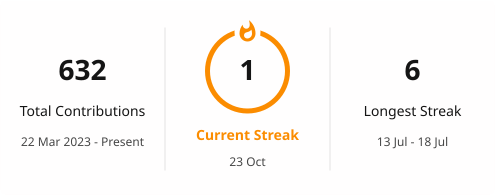

## Florencia del Castillo

**Analista en Sistemas · Cloud & Software · AWS.** Construyo infraestructura serverless y en contenedores, y documento las
decisiones detrás de cada proyecto. 
Ayudante de cátedra en la UNViMe. 
Villa Mercedes, San Luis 🇦🇷

<a href="#english">🇬🇧 Read in English</a>

---

## Proyectos

### Mi Plan de Estudios: planificador académico

Te dice qué materias podés cursar, qué te está trabando y qué te falta para recibirte, y te avisa
cuando se acerca una fecha del calendario académico o vence una regularidad. Modela el plan de
estudios como un grafo de correlativas, con el catálogo de planes de SIU Guaraní (viejos y nuevos),
e importa tu historial desde el reporte de Guaraní (también en PDF) o un Excel, verificándolo contra
el plan oficial. Suma escenarios de "qué pasa si", una constancia de avance imprimible, un enlace de
solo lectura para compartir el avance con un tutor y un panel de coordinación de carrera, con
protección de cohortes chicas. Los avisos salen por WhatsApp, Telegram o email. Corre en una EC2 con
Docker Compose: API (Node + Express + MongoDB) y frontend en contenedores separados detrás de Nginx,
con dominio propio y TLS de Let's Encrypt. Un pipeline de GitHub Actions con OIDC sube las imágenes a
ECR y despliega por SSM, sin SSH ni claves guardadas.

       

[**▸ Probalo**](https://miplandeestudios.com.ar) · en producción, con usuarios reales

### Claudito: optimizador de CVs con IA

Subís un CV, pegás una descripción de puesto, y te devuelve un score de match, sugerencias concretas
que aceptás o descartás una por una, y un PDF en formato Harvard listo para mandar, con una
restricción central: **no inventa nada**. Se puede probar sin cuenta; con cuenta guardás un dossier
de carrera (el registro largo de tus proyectos y logros), que se descompone en unidades de evidencia
en DynamoDB. En cada análisis se eligen las más relevantes para el puesto, cada bullet del CV cita la
unidad que lo respalda y un verificador comprueba que las citas existan y que ninguna cifra quede
fuera del material original. El CV se edita ya formateado, no como Markdown. Es serverless: catorce
Lambdas, Cognito para las cuentas, tres usos de Bedrock (dossier, análisis y generación), WeasyPrint
para el PDF y OCR con Textract para los escaneados. Las sesiones anónimas viven en S3 y se
autodestruyen en 24 a 48 horas; IaC con SAM y deploy por CI/CD con OIDC.

          

[**▸ Probalo**](https://d1u1sqpu5ny5ot.cloudfront.net) · desplegado

### Dockyard: plataforma de deploy tipo Render/Railway

Conectás un repositorio, hacés `git push`, y tu app queda viva en su propio subdominio con HTTPS
válido. Es un proyecto de infraestructura pensado para ser defendible pieza por pieza: en vez de usar
un PaaS, lo construye. Una GitHub App manda un webhook firmado, un worker clona el repo (también los
privados), detecta el stack (Node, Python o Go), construye la imagen Docker, la sube a ECR y la deja
viva detrás de Nginx, con variables de entorno cifradas y secretos en SSM. Un loop de reconciliación
recupera containers caídos y detecta crash loops, y un dashboard muestra logs en vivo y permite
rollback de un click. Todo es reproducible desde cero con CloudFormation, con TLS wildcard vía ACME
DNS-01 y CI con OIDC, sin access keys estáticas. **Fases 0 a 3 completas.** La Fase 4 migró el
runtime a ECS Fargate + ALB como segunda implementación de la misma interfaz, sin tocar el pipeline.
Lo levanté, lo verifiqué y lo desmonté, porque el ALB solo ya cuesta unos 16 USD al mes, y quedó
documentado en un post-mortem.

         

[**▸ Demo**](https://demo.dockyard.dpdns.org) · Fases 0 a 3 completas, Fase 4 documentada

### Costos: gestión para PyMEs gastronómicas

Para que el dueño o dueña de un local gastronómico administre su negocio sin saber de contabilidad:
ventas, gastos, costos, punto de equilibrio, facturación electrónica (ARCA/WSFE) y un asistente que
responde en lenguaje natural con los números reales del negocio. Se cargan datos a mano, con una foto
del ticket (la IA los extrae y clasifica) o con el CSV de "Mis Comprobantes" de ARCA en lote. Suma un
mostrador con lector de código de barras y caja, comparación de proveedores a partir de ofertas en
foto, PDF o texto, rentabilidad por producto, alertas por Telegram y WhatsApp, y cuatro roles con
PIN. Frontend React + Vite (PWA) con el estado en el navegador; una sola Lambda con dos
integraciones: Bedrock (Claude) para la IA y Afip SDK para ARCA. Regla de diseño: se guardan solo
productos, ventas y comprobantes; costo unitario, CIF, equilibrio y alertas se derivan y nunca se
persisten.

     

_Estado: corre local contra la Lambda; todavía sin instancia pública._

### Seguidor-Colectivo: colectivos de Villa Mercedes en tiempo real

Un mapa a pantalla completa que muestra dónde está cada colectivo y cuánto falta para que llegue a
tu parada, más un planificador de viajes. La fuente (ColectivoYa) trae datos que no son confiables
por sí solos, así que la verdad la pone el GPS: guarda los viajes reales en S3 y de ahí aprende los
recorridos de cada ramal, los valida contra las posiciones y oculta las paradas por las que ya no
pasa nadie. También reasigna el sentido (ida o vuelta), que la fuente casi nunca informa bien, y
compara contra la grilla oficial de horarios. Es serverless: CloudFront + S3 para el frontend, una
Lambda, DynamoDB y SAM para la infraestructura.

     

[**▸ Probalo**](https://d37602x6omnenw.cloudfront.net) · desplegado

### Normativa ISI UNViMe: el digesto, ordenado para acreditar

Relevé el índice completo del digesto de la UNViMe (más de 13.000 documentos), hice OCR de las
resoluciones escaneadas y clasifiqué por contenido las que sirven para la acreditación de Ingeniería
en Sistemas de Información, ordenadas por anexo. El resultado es un sitio público con tabla
ordenable, fichas con el PDF de cada resolución y líneas de tiempo que muestran qué norma deja sin
efecto a cuál. Se publica con GitHub Pages y un script regenera todo desde los datos.

    

[**▸ Verlo**](https://flordelcastillo.github.io/normativa-isi-unvime/) · [código](https://github.com/flordelcastillo/normativa-isi-unvime)

### CodeJam UNViMe 2026: landing y muro de fotos en vivo

La landing oficial del CodeJam (30/10/2026) y un muro que se actualiza solo durante la jornada: la
gente sube una foto desde el celular con el marco del evento, un panel de admin la modera y aparece en
el proyector con un QR para sumarse. Suma un ranking de equipos que nace oculto hasta que el jurado lo
publica, y un entrenador de pitch con IA (Claude en Bedrock) con topes por IP para controlar el gasto.
Es serverless de punta a punta: CloudFront + S3, una Lambda, DynamoDB y SAM, todo pay-per-use.

     

[**▸ Verlo**](https://dygd5d0drje17.cloudfront.net) · [código](https://github.com/flordelcastillo/codejam-landing)

---

## Sobre mí

Soy **Analista en Sistemas** y estudio Ingeniería en Sistemas de Información en la UNViMe (2022-presente). También soy **ayudante de
cátedra** en *Expresión y Resolución de Problemas y Algoritmos* y *Programación I*. Co-fundé el
**Club de Programación de la UNViMe** y di talleres y charlas en la Semana de la Ingeniería: Git,
HTML/CSS, Notion para ingenieros, y *Primeros Pasos en la Nube con AWS* junto al AWS User Group San
Luis.

**Cómo llegué:** freeCodeCamp → backend con Java en la Universidad Globant (beca Code Your Future) →
AWS Re/Start en Potrero Digital → [**AWS Certified Cloud Practitioner**](https://www.credly.com/badges/736b6e0f-4c60-4a82-aa06-105653a22aae/public_url) (enero 2026). Ahora: el CodeJam
UNViMe (30/10) y mi Proyecto Final de la carrera.

### Herramientas

| | |
|---|---|
| **Cloud** | Lambda · S3 · Bedrock · CloudFront · API Gateway · EC2 · ECR · Textract · CloudWatch · IAM · VPC |
| **IaC** | AWS SAM · CloudFormation |
| **Lenguajes** | Python · TypeScript · JavaScript · SQL · Bash |
| **Frontend** | React · Vite · Tailwind · Zustand |
| **Ops** | Docker · Docker Compose · GitHub Actions (OIDC) · Nginx · Linux · DNS |

### Contacto

- [LinkedIn](https://linkedin.com/in/flordelcastillo) · Inglés B2

---

<h2 id="english">🇬🇧 Florencia del Castillo</h2>

**Systems Analyst · Cloud & Software · AWS.** I build serverless and containerized infrastructure, and I document the
decisions behind every project. Teaching assistant at UNViMe. Villa Mercedes, San Luis 🇦🇷

## Projects

### Mi Plan de Estudios: academic planner

Tells you what courses you can take, what's blocking you, and what's left before you graduate, and
pings you when an academic-calendar date is coming up or a course's regular status is about to
expire. It models the curriculum as a prerequisite graph, with the SIU Guaraní catalog of study
plans (old and new), and imports your record from the Guaraní report (PDF too) or an Excel file,
checking it against the official plan. It adds "what if" scenarios, a printable progress
certificate, a read-only link to share your progress with a tutor, and a program-coordination
dashboard that protects small cohorts. Alerts go out over WhatsApp, Telegram, or email. It runs on
one EC2 box with Docker Compose: API (Node + Express + MongoDB) and frontend in separate containers
behind Nginx, with its own domain and Let's Encrypt TLS. A GitHub Actions pipeline using OIDC pushes
the images to ECR and deploys through SSM, with no SSH and no stored keys.

       

[**▸ Try it**](https://miplandeestudios.com.ar) · in production, with real users

### Claudito: AI CV optimizer

Upload a CV, paste a job description, and get a match score, concrete suggestions you accept or
dismiss one by one, and a ready-to-send Harvard-format PDF, with one core constraint: **it invents
nothing**. You can try it without an account; with one, you keep a career dossier (the long record
of your projects and achievements) that gets split into units of evidence in DynamoDB. On each
analysis the most relevant ones for the role are picked, every CV bullet cites the unit that backs
it, and a verifier checks that the citations exist and that no figure falls outside the original
material. The CV is edited already formatted, not as Markdown. It's serverless: fourteen Lambdas,
Cognito for accounts, three Bedrock uses (dossier, analysis, and generation), WeasyPrint for the
PDF, and Textract OCR for scanned files. Anonymous sessions live in S3 and delete themselves within
24 to 48 hours; IaC with SAM and CI/CD deploys over OIDC.

          

[**▸ Try it**](https://d1u1sqpu5ny5ot.cloudfront.net) · deployed

### Dockyard: a Render/Railway-style deploy platform

Connect a repo, `git push`, and your app is live on its own subdomain with valid HTTPS. It's an
infrastructure project meant to be defensible piece by piece: instead of using a PaaS, it builds
one. A GitHub App sends a signed webhook, a worker clones the repo (private ones too), detects the
stack (Node, Python, or Go), builds the Docker image, pushes it to ECR, and brings it up behind
Nginx, with encrypted environment variables and secrets in SSM. A reconciliation loop recovers
crashed containers and detects crash loops, and a dashboard shows live logs and one-click rollback.
Everything is reproducible from scratch with CloudFormation, with wildcard TLS via ACME DNS-01 and CI
over OIDC, no static access keys. **Phases 0 to 3 are complete.** Phase 4 migrated the runtime to ECS
Fargate + ALB as a second implementation of the same interface, without touching the pipeline. I
stood it up, verified it, and tore it down, because the ALB alone costs about 16 USD a month, and it's
documented in a post-mortem.

         

[**▸ Demo**](https://demo.dockyard.dpdns.org) · Phases 0 to 3 complete, Phase 4 documented

### Costos: management for small restaurants

So a restaurant owner can run their business without knowing accounting: sales, expenses, costs,
break-even, electronic invoicing (ARCA/WSFE), and an assistant that answers in plain language using
the business's real numbers. Data is entered by hand, by photo of the receipt (AI extracts and
classifies it), or from the ARCA "Mis Comprobantes" CSV in bulk. It adds a point-of-sale counter
with barcode scanning and cash register, supplier comparison from offers sent as photo, PDF, or
text, profitability per product, Telegram and WhatsApp alerts, and four PIN-protected roles. React +
Vite (PWA) frontend with state in the browser; a single Lambda with two integrations: Bedrock
(Claude) for AI and the Afip SDK for ARCA. Design rule: only products, sales, and receipts are
stored; unit cost, overhead, break-even, and alerts are all derived and never persisted.

     

_Status: runs locally against the Lambda; no hosted instance yet._

### Seguidor-Colectivo: live buses in Villa Mercedes

A full-screen map showing where each bus is and how long until it reaches your stop, plus a trip
planner. The upstream source (ColectivoYa) isn't reliable on its own, so the GPS is the source of
truth: it stores real trips in S3, learns each route from them, validates the routes against the
positions, and hides stops nobody serves anymore. It also reassigns direction (outbound or return),
which the source rarely reports correctly, and checks everything against the official timetable. It's
serverless: CloudFront + S3 for the frontend, a Lambda, DynamoDB, and SAM for the infrastructure.

     

[**▸ Try it**](https://d37602x6omnenw.cloudfront.net) · deployed

### Normativa ISI UNViMe: the university's rulebook, organized for accreditation

I crawled the full index of the UNViMe digest (over 13,000 documents), ran OCR on the scanned
resolutions, and classified by content the ones that matter for the accreditation of the
Information Systems Engineering program, organized by annex. The result is a public site with a
sortable table, a detail page with the PDF of each resolution, and timelines showing which rule
overrides which. It's published with GitHub Pages, and one script regenerates everything from the
data.

    

[**▸ See it**](https://flordelcastillo.github.io/normativa-isi-unvime/) · [code](https://github.com/flordelcastillo/normativa-isi-unvime)

### CodeJam UNViMe 2026: landing and live photo wall

The official landing page for CodeJam (Oct 30, 2026) and a wall that updates itself during the event:
people upload a photo from their phone with the event frame, an admin panel moderates it, and it
shows up on the projector with a QR code to join in. It adds a team ranking that stays hidden until
the judges publish it, and an AI pitch coach (Claude on Bedrock) with per-IP limits to keep costs in
check. Serverless end to end: CloudFront + S3, a Lambda, DynamoDB, and SAM, all pay-per-use.

     

[**▸ See it**](https://dygd5d0drje17.cloudfront.net) · [code](https://github.com/flordelcastillo/codejam-landing)

## About me

I am a **Systems Analyst** and I am studying Information Systems Engineering at UNViMe (2022-present). I am also a **teaching assistant**
for *Problem Solving & Algorithms* and *Programming I*. I co-founded the **UNViMe programming club**
and gave workshops and talks at Semana de la Ingeniería: Git, HTML/CSS, Notion for engineers, and
*Primeros Pasos en la Nube con AWS* with the AWS User Group San Luis.

**How I got here:** freeCodeCamp → Java backend at Universidad Globant (Code Your Future scholarship)
→ AWS Re/Start at Potrero Digital → [**AWS Certified Cloud Practitioner**](https://www.credly.com/badges/736b6e0f-4c60-4a82-aa06-105653a22aae/public_url) (January 2026). Right now:
the UNViMe CodeJam (Oct 30) and my degree final project.

**Contact:** [LinkedIn](https://linkedin.com/in/flordelcastillo) ·
English B2

---

<picture>
  <source media="(prefers-color-scheme: dark)" srcset="https://github-readme-stats-seven-psi-95.vercel.app/api?username=flordelcastillo&show_icons=true&include_all_commits=true&hide_border=true&hide_title=true&theme=tokyonight" />
  
</picture>
&nbsp;
<picture>
  <source media="(prefers-color-scheme: dark)" srcset="https://github-readme-stats-seven-psi-95.vercel.app/api/top-langs/?username=flordelcastillo&layout=compact&hide_border=true&langs_count=8&theme=tokyonight" />
  
</picture>

 
 

<picture>
  <source media="(prefers-color-scheme: dark)" srcset="./profile/streak-dark.svg" />
  
</picture>

 
 

<picture>
  <source media="(prefers-color-scheme: dark)" srcset="https://github-readme-activity-graph-tan-two.vercel.app/graph?username=flordelcastillo&hide_border=true&area=true&theme=react-dark" />
  
</picture>

 
 

 

<b>AWS Certified Cloud Practitioner</b> (2026) · <b>AWS re/Start Graduate</b> · <b>AWS Academy Educator</b>

